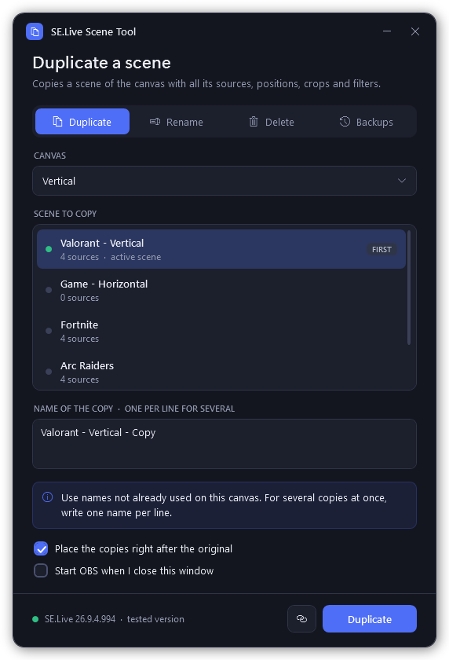

# SE.Live Vertical Scene Tool

Duplicate (and rename) scenes on **SE.Live multistreaming canvases** (vertical canvas for TikTok, YouTube Shorts, etc.) — something the SE.Live dock still can't do.

**v3.0** — built and tested for **SE.Live 26.9.4.994** on **OBS Studio 33.0.0** (Windows 11, October 2026).



## Compatibility

| | Version |
| --- | --- |
| SE.Live (obs-streamelements-core) | **26.9.4.994** — tested |
| OBS Studio | **33.0.0** (64-bit) — tested |
| Windows | 10 (version 1809 or later) / 11 |

Your SE.Live version is shown in the bottom-right corner of OBS's status bar (e.g. `SE.Live 26.9.4.994`). The tool reads it too: the window footer and `-List` say whether it is the tested version.

On a different SE.Live version the tool still runs, but marks it as **not tested**. Before writing anything it checks that the composition file has the structure it knows: if an update changed the format, it stops without touching your files. Duplicates, deletes and the first-scene rename were verified in OBS on 26.9.4.994; everything else was tested on copies of a real 26.9.4.994 composition file. Older SE.Live builds were not re-tested with v3.

## The problem

If you multistream with SE.Live you've probably hit these walls:

- **No "duplicate scene"** on the vertical canvas: every new scene must be rebuilt from scratch — webcam, logo, overlays, positions, all of it.
- **Renaming doesn't stick**: you rename a scene in the dock, and the old name comes back.

## What we found (the short version)

SE.Live does **not** store canvas scenes in the OBS scene collection. Each canvas lives in its own "composition" JSON file:

```
%AppData%\obs-studio\plugin_config\obs-streamelements-core\scoped_config_storage\streamelements_multi-streaming\compositions\
```

SE.Live reads that file on startup and rewrites it while OBS runs and on shutdown. Editing it with OBS closed works — that's what this tool automates, **surgically**: it never rewrites the file, it only splices in the duplicated scene (every other byte stays 100% identical, verified on every run).

Since SE.Live 26.x the canvas is also registered as a native OBS 33 canvas (you'll see `🚀 SE.Live: Vertical` in the scene collection), but its scenes still live only in the composition file. The current format links every scene entry back to its scene (`sceneId`) and canvas (`videoCompositionId`), and filters carry ids too. v3 gives the copy a fresh scene id and fresh entry ids and keeps filter ids as they are: filters belong to the shared source, so SE.Live itself writes the same filter id in every scene that uses that source.

**But there's a second actor.** SE.Live also keeps scene state of its own (dock/web-app state), and reconciles it with the file at startup. In our testing (July 2026 build) this:

- forces the **first scene of the canvas** to be named "Scene 1" (renames revert, deleting it makes it respawn);
- can **remove or re-label scenes** whose identity conflicts with it (we lost a scene this way — recovered from backups).

Scenes created with **brand-new names survive reliably**. That's the foundation of the golden rules below. A detailed bug report for the SE.Live developers is included in this repo (`bug-report.md`).

**On 26.9.4.994 (October 2026, six OBS restarts):**

- Duplicated scenes load in the dock, keep their position in the list and survive SE.Live re-saving the file. Scenes deleted with the tool stay deleted.
- Copies may reuse a name that also exists on the main canvas, even as the active scene: a vertical "Fortnite" next to the horizontal "Fortnite" stays "Fortnite".
- Nothing about these names is stored on disk outside the composition file. SE.Live works them out again at every startup.

### The " 1" bug (found in SE.Live's source code)

SE.Live's plugin core is open source ([obs-streamelements-core](https://github.com/StreamElements/obs-streamelements-core)), and it has two different rules for scene names:

- **Adding a scene** (`addScene` → `GetUniqueSceneName`): the name only has to be unique **within that canvas**.
- **Renaming a scene** (`setScenePropertiesById` → `ObsSetUniqueSourceName` → `isSourceNameUnique`): the name must be unique **across all of OBS**. That means every scene and source of the main canvas, and every scene and scene entry of every SE.Live canvas. If it isn't, SE.Live silently appends " 1", " 2"...

At startup the canvas is created with a placeholder scene called "Scene", and the dock restores the **first** scene through a rename (the other scenes are added). So a vertical first scene called "Valorant", on a setup that also has a horizontal "Valorant", always comes back as **"Valorant 1"**. Renaming it to "Valorant" from the dock fails for the same reason. Renaming it with the tool helps only if the name is unique.

**Fix:** give the first scene a name used nowhere else in OBS, e.g. "Valorant - Vertical". Verified: after a restart it stays "Valorant - Vertical". The tool checks this for you. It refuses to give the first scene a name that would turn into "<name> 1" and suggests one that sticks. `-List` and the Rename window warn you when the current first scene has this problem. The same global rule applies to **any rename you do from the dock**.

The `ptr(...)` ids in the file are just memory addresses of the last session: SE.Live reassigns all of them at every startup. The tool only has to keep them unique inside the file, which it does.

## Golden rules (read before using)

1. **The first scene needs a name used nowhere else in OBS** (e.g. "Valorant - Vertical"), otherwise it shows up as "<name> 1" — see "The \" 1\" bug" above. The tool enforces this.
2. **Duplicate using names not already used on that canvas** (names from the main canvas are fine for every scene except the first).
3. **Rename from the dock only to names used nowhere else in OBS**, or rename with the tool (OBS closed), which handles the rules for you.
4. **Delete with the tool rather than from the dock.** Deleting scenes from the dock is what triggered the scene loss in our July testing. The tool's Delete (with OBS closed) cuts exactly that scene out of the file, after a backup, and refuses to delete the canvas's active scene.
5. The tool makes a **timestamped backup before every change** — and can restore any of them in one click.

## What the tool does

1. Gracefully closes OBS if it's running and waits until SE.Live has finished saving. If OBS runs as administrator, it asks you to close OBS and carries on by itself as soon as OBS is gone.
2. Auto-detects your composition files (or lets you browse to one — portable setups included)
3. Four tabs. The window stays open, so you can do several operations in a row, and OBS reopens once at the end.
   - **Duplicate** — pick a scene and type one or more new names (one per line) to make several copies at once. Same sources, positions, crops, filters. The copies go right after the original, in the order you typed them (untick the box to append them at the end instead).
   - **Rename** — for the first scene it checks the name against all of OBS and suggests one that sticks (rule 1).
   - **Delete** — removes one scene from the canvas (its sources stay in OBS). Not allowed on the active scene.
   - **Backups** — pick a backup by date (it shows which scenes it contains) and put it back. The current state is backed up first, so a restore can be undone too.
4. Validates the result before writing — if anything looks wrong, the file is not touched:
   - all bytes outside the scene being added/removed/renamed are identical to the original,
   - a copy is identical to the original scene apart from name and ids,
   - scene and entry ids stay unique and every entry points to the right scene and canvas.
5. Refuses to work on a file whose format it doesn't recognize (in case a future SE.Live update changes it again), and refuses to write if OBS was reopened or the file changed in the meantime
6. Writes atomically (temp file + swap), reads the result back, and reopens OBS when you close the window

Duplicated scenes share the same underlying sources as the original (webcam, browser sources, logos...), so you only need to swap the game capture and you're done.

## Requirements

- Windows 10 (version 1809 or later) or Windows 11
- OBS Studio with SE.Live installed and at least one canvas created
- PowerShell (built into Windows — nothing to install)

## How to use

1. Download **both files** into the same folder (Desktop is fine):
   - `SELive Scene Tool.bat`
   - `SELive-Vertical-Scene-Tool.ps1`
2. Double-click **`SELive Scene Tool.bat`**. The tool's window opens with no console window behind it (at most a console flashes for an instant).
   - If Windows SmartScreen warns you, click *More info → Run anyway*. Both files are plain-text scripts — feel free to read the source.
   - Tip: the link button next to the main button creates a **Desktop shortcut** with the tool's icon. It opens the tool with no console at all, not even the flash. The shortcut points to the folder the tool is in, so create it again if you move the files.
3. If OBS is open, the tool asks permission to close it (answer any OBS confirmation dialog on screen if one appears).
   - If OBS is set to **run as administrator** (common for game capture), Windows doesn't let a normal program close it. The tool tells you, you close OBS yourself (File → Exit), and the tool continues by itself. When the tool reopens OBS, Windows asks for the usual admin confirmation.
4. Pick a tab (**Duplicate**, **Rename**, **Delete**, **Backups**), the canvas and the scene, then use the button bottom right. The result appears in the window, and you can carry on with other operations.
5. Close the window: OBS reopens (if the box at the bottom is ticked). Check the canvas dock.

### Command line (optional, e.g. for Stream Deck)

```
powershell -ExecutionPolicy Bypass -File .\SELive-Vertical-Scene-Tool.ps1 -List
powershell -ExecutionPolicy Bypass -File .\SELive-Vertical-Scene-Tool.ps1 -NoGui -Scene "Valorant" -NewName "Apex"
powershell -ExecutionPolicy Bypass -File .\SELive-Vertical-Scene-Tool.ps1 -NoGui -Scene "Valorant" -NewName "Apex|Fortnite|Variety"
powershell -ExecutionPolicy Bypass -File .\SELive-Vertical-Scene-Tool.ps1 -NoGui -Rename -Scene "Old Name" -NewName "New Name"
powershell -ExecutionPolicy Bypass -File .\SELive-Vertical-Scene-Tool.ps1 -NoGui -Delete -Scene "Old test"
powershell -ExecutionPolicy Bypass -File .\SELive-Vertical-Scene-Tool.ps1 -NoGui -RestoreFrom "<path to a .bak_ file>"
```

- `-List` prints canvases, scenes (`*` = active) and backup count; read-only, works with OBS open.
- `-NewName "A|B|C"` makes several copies in one go (one backup for the whole batch); they go right after the original, or at the end with `-AtEnd`.
- `-Canvas <name>` or `-File <path>` picks the canvas when you have more than one.
- `-Force` lets the command line close OBS gracefully for you (otherwise it stops if OBS is running).
- `-NoRestart` doesn't reopen OBS afterwards.

## Backups and how to restore

Every operation creates a copy like `<file>.json.bak_20261028_112035305` next to the composition file. Easiest way back: run the tool, open the **Backups** tab, pick the date. By hand: close OBS, copy the backup over the `.json` (same filename), reopen OBS.

Backups are never deleted by the tool; clean up old ones yourself when the folder gets crowded.

## Disclaimer

Unofficial community tool, **not affiliated with StreamElements or the OBS Project**. The composition file format and the reconciliation behavior were reverse-engineered on SE.Live 26.9.4.994 / OBS Studio 33.0.0 (October 2026) and may change in future updates — the tool checks the format and stops if it doesn't recognize it. A backup is always created before writing, but use at your own risk. License: MIT.

And please upvote the official feature request for native duplicate/clone — that, plus a fix for the behavior described in `bug-report.md`, is the real solution. This tool fills the gap until then.
